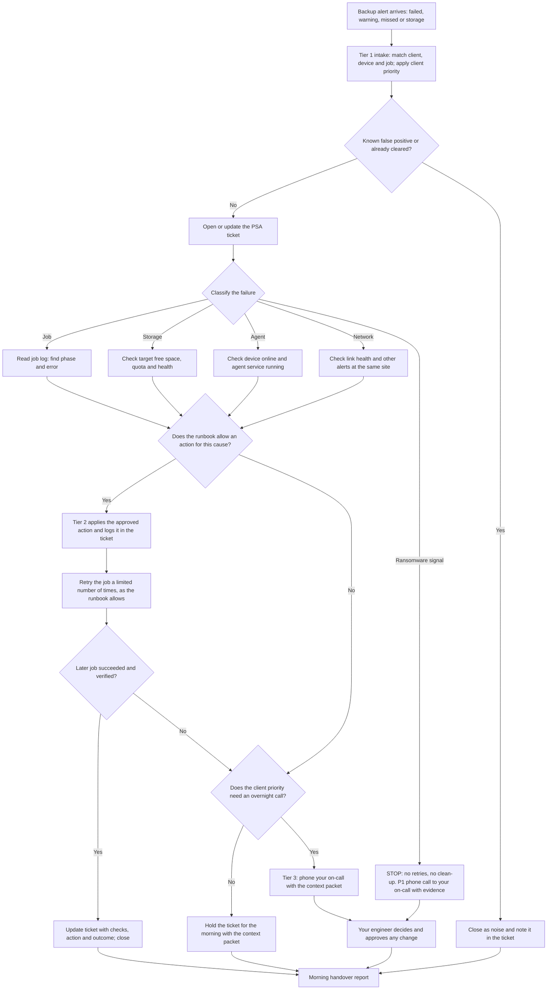

# Page 3: MSP backups fail overnight: how NOC247 handles it

## Page metadata

| Field | Value |
|---|---|
| URL slug | `/msp-backup-monitoring` (the suggested `/msp-backup-failure-monitoring` is longer and drops the primary keyword; see research.md section 6) |
| Canonical | `https://www.noc247.io/msp-backup-monitoring` |
| Title tag (≤60) | `MSP Backup Monitoring: Overnight Failure Flow \| NOC247` |
| Meta description (≤155) | `How NOC247 handles a failed backup overnight: triage, controlled retry, fixes within your permissions, PSA ticket, on-call escalation and a morning report.` |
| H1 | MSP backups fail overnight: how NOC247 handles it |
| Primary keyword | MSP backup monitoring |
| Secondary keywords | failed backup alert triage, overnight backup failure MSP, after-hours backup monitoring, Veeam failed backup alert, Datto backup monitoring, N-able Cove monitoring, Acronis backup alert, Axcient monitoring |
| Page type | Service-support page (not a blog post). Place it outside `/blog`, link it from the Insights hub and from `/managed-noc-services-for-msps` |
| Schema | `WebPage` (or `Article`) + `FAQPage` + `BreadcrumbList`. Do not use `HowTo` markup |
| Breadcrumb | Home > MSP backup monitoring |
| Dates | datePublished 2026-11-16 |

## Body copy

# MSP backups fail overnight: how NOC247 handles it

The job that failed at 11:05 PM is not the problem. The problem is that nobody looked at it until 7:45 the next morning, after the client's file server had been unprotected for a night and a second failure had stacked on top of the first.

This page shows what happens between the failed-backup alert and the morning report: how it is triaged, what is retried, what NOC247 is allowed to fix, what lands in your PSA and when a human at your MSP gets a phone call.

## The flow at a glance

The diagram and the numbered steps below describe the same process. The steps are the full version; the diagram is the shape of it.

<!-- BUILD NOTE: render the visual flow component from the structured steps in "Flow steps (data for the visual)" below. Under it, render the Mermaid diagram as a secondary view with the alt text given there. Remove this comment from the shipped page. -->

### Eight steps, in order

1. **The alert arrives.** A failed, warning, missed or storage alert reaches the NOC from your RMM, backup console or alert mailbox.
2. **Intake and ticket.** The alert is matched to a client, device and job, de-duplicated and given the priority from that client's priority table. A PSA ticket is opened or updated.
3. **Triage.** The analyst sorts the failure into one of five branches: job, storage, agent, network or ransomware signal.
4. **Controlled retry.** If the cause is transient and the runbook allows it, the job is retried a limited number of times, never in a loop.
5. **Remediation within permissions.** Tier 2 applies only the actions written into your runbook for that cause.
6. **Verify and document.** The ticket stays open until a later job succeeds, and every check and action is recorded in it.
7. **Escalate to your on-call.** If the fix is outside the runbook, the retry failed or a ransomware signal appears, your engineer gets a phone call with a full context packet.
8. **Morning handover report.** Everything the night did, ranked by what needs a person.

## Step 1 and 2: the alert and the ticket

A backup alert can arrive three ways: as an RMM monitor, as a status in the backup product's own console, or as an email routed to a mailbox. Whichever it is, the first thing the NOC does is not to touch the job.

It identifies the client, the device and the job, and checks whether the alert is a known false positive or has already cleared. It then looks up the client's priority table. A failed backup on a domain controller at a 120-seat client is not the same priority as a missed workstation backup at a ten-person office. The ticket in your PSA carries that priority from the start, under your technician identity.

## Step 3: the five-way triage

Most overnight backup failures come from one of five places. Sorting them first stops the NOC from retrying a job that will never succeed.

| Branch | What it looks like | First checks | Typical action in a runbook | Escalate when |
|---|---|---|---|---|
| **Job** | Job fails or completes with warnings; the error names a phase such as snapshot, application-aware processing or write | Read the job log and find the phase and error text | Retry the failed items once after a known-good fix, such as restarting a stuck backup service | The same job fails twice, or the error is a configuration or credential problem |
| **Storage** | "Not enough space", repository or target nearly full, quota reached | Free space on the target, quota, whether other jobs are writing at the same time | Free space only where the runbook names what may be cleared; otherwise raise a ticket for the day team | Anything that means deleting restore points or changing retention |
| **Agent** | Device not reachable, agent offline, job did not start | Is the device online, is the agent service running, was there a reboot or patch window | Restart the named agent service; wait for the device to come back from a patch window | The device is down, which is a separate incident |
| **Network** | Offsite sync lag, timeouts, jobs failing at several clients at the same site | Link state, other alerts from the same site, ISP notices | Open the network ticket, link the backup ticket to it, re-check the job after the link returns | A circuit is down for a client with a P1 SLA |
| **Ransomware signal** | Sudden jump in changed data or backup size, mass file renames, a job that "succeeds" with unusual contents, backup files or restore points altered or deleted, an EDR alert at the same time | Compare with the job's recent history and look for related alerts on the same device | **None.** Stop. No retries and no clean-up | Always. Phone your on-call as a P1 |

The ransomware branch is the one where the correct action is to do less. This page describes escalation, not incident response: the NOC recognises the pattern, stops making changes, preserves the evidence in the ticket and gets your engineer on the phone.

## Step 4: controlled retry

A retry is useful when the cause was transient, such as a snapshot that failed while another job held a lock. It is harmful when it hides a real fault.

- **Retries are limited and written down.** The number of retries and the wait between them are agreed per client in the runbook.
- **A retry follows a diagnosis.** The analyst finds the cause first, then retries once the cause has been dealt with.
- **A second failure ends the loop.** Two failures on the same job means the problem is not transient, so the ticket goes to Tier 3 or is held for the day team, depending on priority.
- **Repeated failures become a problem ticket.** If the same job keeps failing across several nights, the morning report names it so your team can fix the cause.

## Step 5: remediation within agreed permissions

NOC247 works under your runbook. Tier 2 applies known-good remediations that you have approved, and everything else is escalated.

| Tier | Typical backup actions | Who decides |
|---|---|---|
| Tier 1: validate and diagnose | Read job logs and console status, check device and agent state, check free space, link the ticket to related alerts | NOC247 analyst |
| Tier 2: known-good remediation | Restart a named backup service or agent, re-run a failed job after a documented fix, clear a stuck queue | Written into your runbook per client |
| Tier 3: escalation | Anything that changes configuration or removes data | Your on-call engineer, who approves it in the ticket |

Some actions need an explicit yes from you every time: deleting restore points, changing retention, editing job configuration, rotating or changing backup credentials, and rebooting production servers. They never sit in a night shift's default permissions.

## Step 6: verify and document

A job that is retried is not a job that is fixed. The ticket stays open until a later job succeeds, and where your SOW calls for it, a restore check is run on the cadence you've approved.

Every ticket carries the same fields, so your day team can read it in 30 seconds:

- Client, device, backup product and job name
- Failure phase and error text
- Checks run and what each showed
- Action taken, by whom and with which approval reference
- Retry result and the time of the next scheduled job
- Named owner and the next action, with a deadline

## Step 7: escalation to your on-call

Not every failed backup wakes someone. Your priority table decides. A critical server whose last good backup is more than a night old gets a phone call. A single workstation does not. The runbook says which is which.

When a call is made, it opens with your company greeting and the escalation tree you wrote: phone first, then the next contact after the agreed number of minutes. The call comes with a context packet:

- The alert timeline and the client's priority
- The checks run and what each showed
- Retries made and their results
- The last successful backup and the next scheduled job
- Any related alerts, such as a disk, a link or an EDR alert
- A recommended next step

Your engineer should not be woken and told only "a backup failed".

## Step 8: the morning handover report

By the time your day team arrives, the report tells them what happened and what needs a person:

- Backup alerts received, tickets opened and tickets closed
- Failures fixed overnight, each with its ticket ID and the approval reference
- Failures still open, ranked by urgency, with the next action
- Jobs that keep failing, with a proposal to fix the cause
- Anything that looked like a ransomware signal, listed first

The report is built from your PSA timestamps, so every number traces back to a ticket you can open.

## What the alert looks like in common backup tools

The flow is the same whichever product you run. What changes is where the status appears and what the first check is. Exact alert names vary by product and version, so your runbook uses the wording in your own console.

| Tool | Where the status shows up | First check |
|---|---|---|
| **Veeam Backup & Replication** | Job session result of Success, Warning or Failed; repository and proxy state | Which phase failed: snapshot, guest processing such as VSS, or repository write; then free space on the repository |
| **Datto (BCDR devices)** | Failed or missed backup, agent unreachable, failed screenshot verification, offsite sync lag | Device and agent connectivity, then the last successful snapshot and local storage |
| **Acronis Cyber Protect** | Failed or missed backup plan alerts in the management console | Whether the agent is online and the plan started, then target and cloud quota |
| **N-able Cove Data Protection** | Session status such as Failed or Completed with errors, or no recent backup for a data source | The data source affected and the last successful session, then the device and its connectivity |
| **Axcient x360Recover** | Protected-system status and failed verification of a recovery point | Agent or appliance connectivity, then the verification result for the latest recovery point |

Tell us which backup product each client runs on the scoping call, and we write the product-specific steps into the runbook.

## What NOC247 doesn't do

- **Redesign your backup strategy.** Recommendations on what to change go in the morning report, and your team decides.
- **Delete data or change retention without your approval.**
- **Replace your incident response.** A ransomware signal gets a phone call and evidence, not a clean-up.

## See how many of your overnight alerts really need a person

Send one week of after-hours alerts from your RMM and the free After-Hours Alert Audit shows which pages needed a human and which were noise. If backup failures are on your list, it will show those too.

- **[Get the free After-Hours Alert Audit](/free-alert-audit)**
- **[Book a 30-minute scoping call](https://calendly.com/noc247-scoping-call/30min)**

Related: [Managed NOC services for MSPs](/managed-noc-services-for-msps) · [24/7 NOC support](/247-noc-support) · [Cut RMM alert noise](/blog/reduce-rmm-alert-noise) · [NinjaOne NOC](/ninjaone-noc) · [Auvik NOC](/auvik-noc) · [Case studies](/case-studies) · [Pricing](/pricing)

## FAQ (for FAQPage schema)

**Does a failed backup wake someone up?**
Not always. The client's priority table decides. A critical server whose last good backup is more than a night old gets a phone call to your on-call engineer, and a single workstation waits for the morning report. The runbook records which is which.

**Will NOC247 just keep re-running failed jobs?**
No. Retries are limited and agreed per client in the runbook, and they come after a diagnosis. A second failure on the same job means the cause is not transient, so it is escalated or held for your day team, and a job that keeps failing is named in the morning report.

**What can NOC247 change in our backup tool?**
Only the actions written into your runbook, such as restarting a named service or re-running a failed job after a documented fix. Deleting restore points, changing retention, editing job configuration and changing backup credentials need your explicit approval.

**How do you handle a possible ransomware signal in a backup?**
The NOC stops making changes, records the evidence in the ticket and phones your on-call engineer as a P1. It does not retry the job or clean up. This is escalation, not incident response.

**Do you test restores?**
Spot-check restoration checks run on the cadence you approve per client in your SOW. The result goes into the ticket and the morning report.

**Which backup products does this cover?**
The flow is the same for any product, because the NOC reads the alert and job status and acts within your runbook. Tell us whether you run Veeam, Datto, Acronis, N-able Cove or Axcient on the scoping call so the product-specific steps are written in.

---

## Flow steps (data for the visual)

Render these as an accessible, text-first component (an ordered list of cards joined by CSS connectors). This is the source of truth; the Mermaid diagram below is a secondary view. Every step is plain HTML text, with no image-only content.

```yaml
flow:
  title: "Overnight backup failure: from alert to morning report"
  steps:
    - id: 1
      name: "Alert arrives"
      detail: "A failed, warning, missed or storage alert reaches the NOC from your RMM, backup console or alert mailbox."
      who: "Automated"
      permission: "None needed"
      output: "Alert received"
    - id: 2
      name: "Intake and ticket"
      detail: "Match client, device and job. De-duplicate. Apply the client's priority. Open or update the PSA ticket."
      who: "NOC247 Tier 1"
      permission: "Tier 1: validate and diagnose"
      output: "PSA ticket under your technician identity"
      branch_note: "Known false positive or self-cleared: close as noise and note it in the ticket."
    - id: 3
      name: "Triage: five branches"
      detail: "Sort the failure into job, storage, agent, network or ransomware signal."
      who: "NOC247 Tier 1"
      permission: "Tier 1: validate and diagnose"
      output: "Ticket updated with the branch and the checks run"
      branches: ["Job", "Storage", "Agent", "Network", "Ransomware signal"]
      branch_note: "Ransomware signal: stop. No retries or clean-up. Go straight to step 7 as a P1."
    - id: 4
      name: "Controlled retry"
      detail: "If the cause is transient and the runbook allows it, retry a limited number of times. Never loop."
      who: "NOC247 Tier 2"
      permission: "Tier 2: known-good remediation"
      output: "Retry result recorded"
    - id: 5
      name: "Remediation within permissions"
      detail: "Apply only the actions written into your runbook for this cause. Anything else goes to step 7."
      who: "NOC247 Tier 2"
      permission: "Tier 2: known-good remediation"
      output: "Action and approval reference in the ticket"
    - id: 6
      name: "Verify and document"
      detail: "Keep the ticket open until a later job succeeds. Record checks, actions, retry result and next scheduled job."
      who: "NOC247 Tier 2"
      permission: "Tier 1 and 2"
      output: "Complete ticket with a named owner and next action"
    - id: 7
      name: "Escalate to your on-call"
      detail: "Phone your engineer with a context packet if the fix is outside the runbook, a retry failed, or a ransomware signal appeared. Lower-priority failures are held for the morning."
      who: "NOC247 Tier 3 handover to your engineer"
      permission: "Tier 3: your on-call decides and approves"
      output: "Call logged in the ticket"
    - id: 8
      name: "Morning handover report"
      detail: "Everything the night did, ranked by what needs a person. Built from your PSA timestamps."
      who: "NOC247 shift lead"
      permission: "None needed"
      output: "Report to your day desk"
```

**Layout guidance:**

- Desktop: a vertical flow of eight cards with a connector line, branches 3a to 3e as five small chips inside step 3, and the ransomware chip styled differently with a "to step 7" label.
- Mobile: the same cards stacked, connectors as thin vertical lines.
- Use real `<ol>`, `<li>`, headings and text. Colour is never the only signal (the ransomware chip also carries the words "stop" and "P1").
- Add a `<details>` below the diagram labelled "Text version of the diagram" containing the eight numbered steps from the body copy.

## Mermaid diagram

Alt text (put in a `<figure>` with `<figcaption>`): "Flowchart showing how a failed backup alert is handled overnight. The alert is ticketed, triaged into job, storage, agent, network or ransomware signal, retried within the runbook, fixed within permissions, escalated to the on-call engineer by phone when needed, and summarised in a morning handover report."



## Internal links on this page

| Anchor text | Target | Placement |
|---|---|---|
| managed NOC services for MSPs | `/managed-noc-services-for-msps` | Related line, and the intro of "What NOC247 doesn't do" |
| 24/7 NOC support | `/247-noc-support` | Related line |
| cut RMM alert noise | `/blog/reduce-rmm-alert-noise` | Step 1 and 2 section (add inline: "noisy alerts are tuned, not ignored") |
| NinjaOne NOC | `/ninjaone-noc` | Related line |
| Auvik NOC | `/auvik-noc` | Network branch row (add inline: "Auvik also reports network configuration backups") |
| case studies | `/case-studies` | Related line |
| free After-Hours Alert Audit | `/free-alert-audit` | Intro CTA, closing CTA, FAQ |
| pricing | `/pricing` | Related line |
| scoping call | `https://calendly.com/noc247-scoping-call/30min` | Closing CTA |
